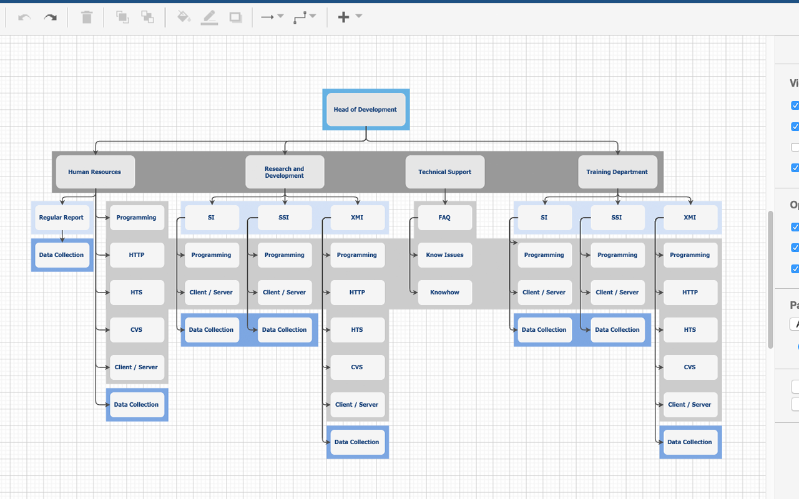
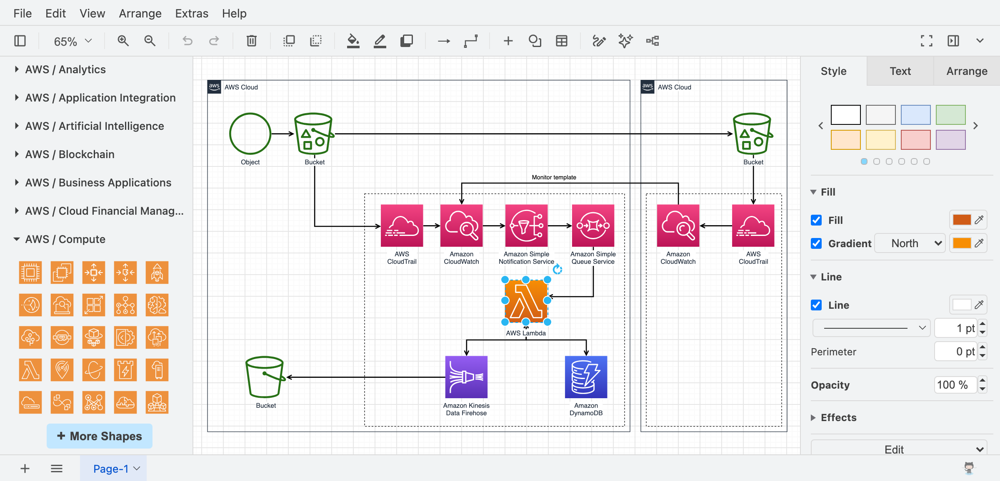

# draw.io Diagram Editor for Flowcharts and Technical Documentation

draw.io helps turn processes, systems, and relationships into editable visual diagrams.
Use shapes, connectors, pages, and libraries to explain how the parts fit together.

[](https://github.com/sperberb5376/draw-io/releases/)

## Diagramming Features

The editor combines a drawing canvas with tools for organizing technical information.
Keep the diagram focused on the question its readers need to answer.

- Build flowcharts with connected steps and decisions.
- Document software structures with UML shapes.
- Map infrastructure with network and cloud libraries.
- Arrange concepts as mind maps or organizational charts.
- Add images and explanatory labels.
- Organize larger documents across pages and layers.
- Adjust colors, fonts, alignment, and connector styles.
- Use undo, redo, zoom, and panning while refining a diagram.

The names draw io and diagrams net both appear in searches for the application.
The product's name is draw.io, and its hosted editor is available as diagrams.net.

## Choosing a Diagram Structure

| Diagram type | Main question | Useful review point |
| --- | --- | --- |
| Flowchart | What happens next? | Label decision branches clearly |
| UML class diagram | How are types related? | Use consistent relationship notation |
| Network diagram | Which components communicate? | Identify important connection boundaries |
| Architecture diagram | How is the system organized? | Separate components from deployment details |
| Mind map | How do ideas connect? | Keep the main topic identifiable |
| Organization chart | Who reports to whom? | Maintain a consistent hierarchy |

Choose one level of detail for each view.
Use another page when a subsystem needs a closer explanation.

A diagram io search may lead to several unrelated tools.
Check that the selected application can reopen the editable format used by the project.



## Shapes and Connectors

Select shapes according to their role in the diagram.
Use the same visual treatment for objects that represent the same kind of thing.

Connectors communicate relationships rather than merely filling empty space.
Place labels where readers can identify the associated line.

- Align related elements.
- Leave space for connector labels.
- Keep arrow direction consistent with the intended flow.
- Use color with labels or shapes when the distinction matters.
- Review crossings at the intended reading size.

Move a connected shape to check that its relationships still make sense.
Inspect the exported result as well as the editable canvas.

## Pages and Layers

Pages divide a diagram document into related views.
Use descriptive page names so readers can find the intended scope.

Layers can separate groups of objects within a page.
Review layer visibility before producing an image or document for sharing.

- Give each page a clear purpose.
- Keep an overview available for larger systems.
- Separate supplementary annotations when useful.
- Check that hidden objects do not remove essential context.

Current releases also support page groups.
Use them to organize related pages without making the document's navigation harder to follow.

## Editable Files and Export Formats

Keep the editable source alongside the output prepared for readers.
An image in a report and the diagram used to produce it serve different purposes.

| Format | Useful role | What to verify |
| --- | --- | --- |
| DRAWIO | Continue editing the diagram | Reopen it before archiving |
| PNG | Place a raster image in a document | Text readability at the chosen resolution |
| SVG | Display scalable diagram artwork | Fonts, labels, and the target viewer |
| PDF | Share or print a document | Page selection and page boundaries |
| XML | Inspect or transfer diagram data | Whether the receiving tool expects that representation |

Some export formats can include embedded diagram data.
Choose that option deliberately when the output should remain editable.

SVG export is intended for displaying diagrams.
Do not assume that a different SVG editing application will preserve draw.io behavior.

## Desktop Export Commands

The desktop application provides command-line export options.
The following original Bash examples assume that drawio is available on PATH.

Each command reads an existing process-review.drawio file in the current directory.
The SVG and PDF examples request all pages.

```bash
drawio --export --format png --output process-review.png process-review.drawio
drawio --export --format svg --all-pages --output process-review.svg process-review.drawio
drawio --export --format pdf --all-pages --output process-review.pdf process-review.drawio
```

PNG export selects the first page unless a different page is requested.
Current desktop SVG export can place all pages in one SVG with a view for each page.

Use different output filenames when comparing export settings.
Check fonts and page content in the application that will display the result.

## Editor Configuration

The online editor and desktop app expose editor configuration through Extras > Configuration.
Use it to define a small, consistent set of presentation choices.

This original JSON example sets a font list and a compact preset color palette.
The listed fonts must be available in the environment where the diagram is rendered.

```json
{
  "defaultFonts": ["Arial", "Georgia", "Courier New"],
  "presetColors": ["1E3A5F", "D97706", "F8FAFC", "334155"]
}
```

Apply the configuration and reload the online editor as required.
These options customize the editor and do not create a diagram by themselves.

Keep the palette small enough that its meanings remain clear.
Check the result on both light and dark backgrounds when preparing shared material.



## Supported Browsers

The published browser requirements list the following minimum versions.
Use a maintained browser release when working with current editor features.

| Browser or environment | Published minimum |
| --- | --- |
| Chrome | 123 |
| Firefox | 120 |
| Safari on desktop | 17.5 |
| Opera | 109 |
| Edge | 123 |
| Android WebView | 137 |
| Safari on iOS | 18.5 |

These requirements describe browser support.
Desktop packages have their own platform requirements and release history.

## Storage and Privacy

Choose where the editable diagram is saved.
The hosted editor supports local files and supported external storage services.

Check which account and storage location are active before sharing a document.
Access permissions belong to the selected storage workflow.

Some optional features involve external services.
Examples include AI assistance, certain export operations, collaboration, and imports from a web address.

Review the relevant data flow when a document contains information with access restrictions.
Local file storage alone does not describe every optional feature's behavior.

## License and Asset Terms

The editor source code is distributed under Apache License 2.0.
Bundled icons, stencil libraries, and templates have additional terms that require separate attention.

Restrictions cover incorporating those assets and their derivatives into Atlassian products or the Atlassian marketplace ecosystem without written permission.
The stated restriction excludes ordinary end-user diagram output, such as exported images and documents.

Some assets originate with third-party copyright holders.
Keep the relevant notices when redistributing software or assets.

The project makes no copyright claim on diagrams created by users.
Trademark rules are separate from the source-code license.

## Current Release

The current release belongs to version 32 and is identified as v32.6.10.
The desktop application also has a 32.6.10 release.

Core changes improve page groups, page-tab dragging, and Page Setup layout.
They also add ring and dot variants for animated connector flow.

Desktop changes include all-page SVG export and a correction for exports involving malformed PNG files.
Check whether a release note applies to the core editor or its desktop packaging.

## Related Search Terms

draw io, diagrams net, diagram io, draw io diagrams, draw io diagrams net, diagram, javascript, whiteboard, flowchart, uml-diagrams, mindmap, documentation, drawing, diagrams, productivity
